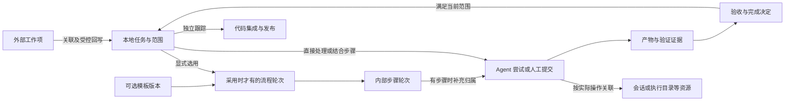

# Reed：业务领域模型

日期：2026-10-28（Asia/Shanghai）。状态：业务建模评审稿，尚未实现。

2026-10-30 业务口径更新：任务类型、统一生命周期、可选流程与执行事实分别管理；共享前端已按此口径调整本地模拟交互，Core 业务仍未实现；模拟实现范围见[前端开发](../engineering/frontend.zh-CN.md)。

2026-10-29 汇总：本文为独立 Reed 工程的现行业务设计，相关业务尚未实现。Core 统一执行规则，Tauri／宿主页面只是客户端；工程与运行机制以[架构总览](../architecture/overview.zh-CN.md)及专题文档为准。原始材料与哈希见[来源记录](../references/provenance.zh-CN.md)。

产品名称 **Reed**，副标题 **Many agents. One flow.**。本稿承接[架构方案](../architecture/overview.zh-CN.md)和[交互设计](interaction.md)，明确业务概念、关系、生命周期、完成条件与来源归属。只做业务设计，不定义数据库表、字段类型、接口参数、代码类或部署方式；不改变当前视觉选择。

操作的前置、事实变化、失败及恢复以[业务操作流](operation-flows.md)为配套规格，包含 F01–F18 和逐项走查；阅读模型时不能将关联、候选、执行结果或整理操作理解成自动推进。

## 1. 核心业务决策

| 编号 | 决策 |
| --- | --- |
| B01 | Task 是独立推进和验收的一件工作，本地身份稳定；不以来源编号、会话或分支为身份 |
| B02 | 类型、生命周期、可选内部流程分开；需求、开发、测试、验证、文档等类型共用同一生命周期 |
| B03 | 类型未选时显示未分类，采用通用任务要求；默认无流程，推荐模板不自动成为已采用模板 |
| B04 | 一个 Task 最多一个当前处理上下文；显式采用流程才有当前 WorkflowInstance/StageRun，不为直接处理路径制造空阶段 |
| B05 | 目标草稿与已采纳范围分开；按实际处理需要确认输入，任务提交评审前固定本轮目标和可判断验收条件 |
| B06 | 任务级验收、内部步骤接受、执行结果与证据适用性分别记录；内部步骤通过不自动完成整件任务 |
| B07 | 人工和 Agent 都是正常处理方式；无 Agent 或无内部流程也可以提交产物并完成任务 |
| B08 | 父子/依赖表示范围和前置关系，各任务有独立类型、生命周期及完成依据，不自动传递状态 |
| B09 | 会话、分支、工作区和文档可关联 Task；步骤归属按实际存在补充，参考关联不赋予执行控制权 |
| B10 | 外部类型/状态作为来源事实保留；映射只提出本地动作，仍核对本地生命周期、产物和验收条件 |
| B11 | 任务级评审通过形成 CompletionDecision 后才已完成；PR、发布、测试质量和外部同步各有独立事实 |
| B12 | 生命周期为待办、处理中、评审中、已完成、已归档；日常看板四列，归档进历史，不删除资源或补造完成 |

## 2. 业务语言

| 概念 | 业务含义 | 与相邻概念的区别 |
| --- | --- | --- |
| Reed 项目 Project | 组织一组工作，关联候选仓库和外部来源范围 | 不等于一个 Git 仓库或一个云效项目；任务可以暂未归组 |
| 任务 Task | 有独立类型、目标、范围、生命周期和验收责任的一件工作 | 不等于完整研发四阶段、聊天或一次 Agent 调用 |
| 任务类型 TaskType | 工作性质，如需求、开发、测试、验证、文档 | 不决定生命周期，不强制采用某个流程 |
| 任务生命周期 | 待办、处理中、评审中、已完成、已归档 | 不以执行、步骤索引或外部状态代替 |
| 范围版本 ScopeRevision | 已采纳的目标、验收条件、必要交付及范围边界 | 草稿保存、改标题、换显示位置不必产生新范围版本 |
| 模板版本 WorkflowTemplateVersion | 可选内部步骤、前置条件、执行方式和产物规则的版本 | 推荐不等于采用；内部步骤不替代任务生命周期 |
| 流程轮次 WorkflowInstance | 显式采用某模板版本开展的一轮可选流程 | 无流程时不存在；已结束或被替代的记录保留 |
| 内部步骤 Stage | 已采用模板中的业务步骤，沿用阶段这一业务术语 | 不等于任务类型或任务生命周期；四个研发名称不是固定枚举 |
| 阶段轮次 StageRun | 针对已固定业务输入、目标及验收要求开展的一轮阶段工作 | 同一阶段可返工多轮；当前阶段的候选产物可反复修改 |
| Agent 尝试 AgentAttempt | 为 Task 当前范围，或实际存在的 StageRun 发起的一次可追踪执行 | 可包含多轮原生对话、工具调用和等待答复，不按聊天消息拆分 |
| 人工提交 ManualSubmission | 人工提交材料及其输入、成果和执行说明 | 不冒充 AgentAttempt 或自动工具的运行结果 |
| 验收 Acceptance | 明确区分任务级验收与内部步骤接受，记录规则、证据和决定者 | 任务级通过可形成完成决定；步骤接受不替代它 |
| 产物 Artifact / Version | 文档、报告、代码成果等业务材料及其明确版本 | 文件路径只说明位置，不能说明内容版本及有效性 |
| 外部工作项 ExternalItem | 云效等来源系统中可准确识别的工作对象及观察事实 | 由来源系统拥有，不被本地 Task 状态替代 |
| 交付引用 DeliveryRef | 提交、PR/MR、合并或发布等交付事实 | 研发验收不自动产生 Git/发布动作，合并也不自动代表上线 |

「负责人」还须区分三种含义：任务的业务责任人、实际执行 Agent/人工，以及外部工作项里的负责人字段。外部回写的主导任务不是一个人，也不等于上述任何负责人字段。

### 2.1 为操作闭环补齐的业务记录

| 记录 | 归属及含义 | 重要约束 |
| --- | --- | --- |
| 验收项 AcceptanceCriterion | 已采纳范围中的可单独判断、可引用的承诺 | 区分必要性、通过依据与责任；取消已承诺条件走范围变更，不借跳过步骤抹掉 |
| 变更/关联建议 Proposal | 某任务/材料/映射的候选及其来源、依据版本和影响 | 提出、采用、放弃、过期分别记录；新候选不自动替代已采用内容 |
| 处理准备 Preparation | 归属 Task 的执行计划，采用步骤时补充 StageRun 归属 | 保存计划或创建资源不等于执行；可没有 AgentAttempt，实际交接前固定输入并再核对 |
| 完成决定 CompletionDecision | Task 本轮范围基于任务级验收/证据形成的结论，流程引用按实际存在记录 | 历史发生事实保留，当前适用性可有效、待复核或被后轮替代；关闭意图引用具体决定 |
| 推进控制/待处理事项 | 暂停、阻塞、停止尝试请求及待核查原因 | 不增加任务主状态；任务级取消/放弃尚待单独定义，见 §7 |

这些是既有任务/流程中的业务记录，不要求新建五个独立系统或通用审批引擎。其具体数据结构留待后续设计。

## 3. 五组业务边界

| 边界 | 拥有的业务事实 | 引用其他边界的内容 |
| --- | --- | --- |
| 工作定义 | 项目归属、任务目标、已采纳范围、任务关系 | 外部来源原文、参考材料 |
| 流程与验收 | 模板版本、流程/阶段轮次、推进条件、验收与完成决定 | 任务范围、产物和执行结果 |
| 执行协作 | 执行尝试、人工提交、实际执行目标、观测结果 | 准确会话、工作区与输入快照 |
| 资源与证据 | 会话/代码资源引用、材料版本、验证证据、交付事实 | 产生它们的任务、阶段和执行来源 |
| 外部协作 | 外部对象、关联、映射、同步意图与核查/处置 | 主导任务及其允许对外表达的结果 |

这是业务职责划分，不要求拆成五个服务、数据库或软件包。四端是进入同一业务的渠道；MCP、HTTP 或原生桥不产生另一套任务模型。

图表示业务依赖，箭头不是自动执行、授权或创建资源的动作。

## 4. 关系与归属

| 关系 | 首版约束 |
| --- | --- |
| 项目—任务 | 一个项目包含多任务；任务当前属于零或一个项目，可先在未归组中工作 |
| 项目—仓库/来源项目 | 一个项目可跨多个仓库和外部项目；这些对象不因此具有相同身份 |
| 任务—范围版本 | 一个任务有多个历史版本，最多一个当前已采纳版本；首次确认任务范围前可只有草稿 |
| 任务—流程轮次 | 可为零；显式采用时最多一个当前流程轮次，历史版本保留；无流程也能完成任务 |
| 流程轮次—阶段轮次 | 一个阶段可有多轮返工；已采用流程按其顺序推进，同一步骤只有一个当前待完成轮次 |
| 任务/步骤—执行来源 | 直接路径归 Task 当前范围，采用步骤时加 StageRun；首版不默认并行写入同一处理目标 |
| 任务/阶段—会话 | 历史上多对多；执行时一个未收敛 Attempt 归属一个明确原生执行会话，该会话不能同时被另一受管理 Attempt 占用 |
| 任务—工作区集合 | 一个任务可有多个历史集合；每个集合含一个或多个按仓库区分的工作区 |
| 任务/阶段—产物版本 | 多对多引用；产物有自己的历史，接受和复用均指向明确版本 |
| 任务—外部工作项 | 多对多引用；主回写关系另受单一主导规则约束 |
| 任务—任务 | 拆分、必要依赖、普通关联分别有明确含义，不用一种无类型链接表达所有关系 |

任务的生命不依赖资源的生命：关掉会话窗口、删除远端分支或断开来源连接不会删除任务。工作区也不随一次 Agent 回答结束而消失。

## 5. 任务、草稿与已采纳范围

### 5.1 一件任务的基本内容与类型

标题必填即可创建待办任务。类型、项目、说明、仓库及参考资料可选或后补；未选择类型时显示未分类，按通用任务要求处理。创建不启动 Agent、不生成阶段产物、不采用默认研发模板。开始处理只明确用户投入这件工作；具体执行按实际操作补齐输入、权限、资料和上下文。

| 类型 | 典型工作与产物 | 任务级验收关注点 |
| --- | --- | --- |
| 需求类 | 澄清问题、范围、限制和需求说明 | 目标和边界清楚，验收条件可判断 |
| 开发类 | 实现约定变更、代码快照与自检说明 | 变更覆盖约定目标，必需自检/证据满足 |
| 测试类 | 设计/执行测试、结果和缺陷报告 | 约定覆盖、实际执行和结果可核查；是否必须全绿由目标决定 |
| 验证类 | 对指定对象/版本复核条件并形成结论 | 对象准确、方法与证据充分，满足约定的结论要求 |
| 文档类 | 撰写/更新文档及评审版本 | 内容完整准确，满足约定受众和交付要求 |

类型示例可按后续产品需求扩展，不是五套状态机。未分类不成为新类型专用流程或新生命周期状态。创建/开始不要求同时填完整验收表；提交任务评审前必须有已明确目标、范围、必要交付和可判断的验收条件。

修改类型不自动推进、验收或改变执行位置。若影响已采纳范围、产物要求或完成条件，先预览差异并按 §5.2/§9 重新确认；评审中先撤回评审，已完成或已归档需要继续工作时先明确重开。仅更正展示归类也不得改写历史验收所用类型/规则。

个人可维护任务类型的名称、说明、图标和推荐模板。类型与模板为多对多推荐；类型停用只影响后续选取，
保留任务及历史评审的准确归类。已引用类型不得直接删除；未分类为保留兜底。模板和类型不各自产生任务状态机。

### 5.2 草稿确认与变更

目标/说明/参考材料可以先是草稿；保存不等于产物已验收。没有需求阶段的任务也能澄清目标，不为此创建虚假的需求 StageRun。第一次明确采用本轮目标、范围及验收条件时形成范围 V1；选用流程时再关联准确流程/步骤，无流程则直接作为 Task 的处理和评审依据。

开始人工整理或让 Agent 协助澄清时，基本目标即可继续补充；有副作用的执行前先确认本次允许的操作范围和输入。进入任务级评审时固定被审范围与成果版本，不把边处理边变化的草稿当作可重复验收对象。

范围已采纳后，外部更新、用户编辑或 LLM 分析只产生待采纳候选。采纳实质变化形成新范围版本，已选流程重判对应轮次和步骤；无流程直接重判任务成果与评审依据。不因改标题、归组或排版自动扩大范围，也不沿用不适用的旧通过标记。

采用影响被审范围、验收条件、类型规则、模板或成果的变更前，评审中任务先撤回到处理中并保留原提交；可明确组合“撤回并采用”，最终停留处理中，不自动重新提交或通过；接纳时核对当前状态/版本，保留撤回原因，不能在评审中替换被审依据。已完成任务先明确重开，已归档任务先恢复到已完成再重开。保存候选或不影响这些依据的展示整理不要求重开；旧证据实际失效则按 §8.3 记录待复核，不隐式改主状态。

已有暂停控制在范围变更后保留；采用变更不等于解除暂停或停止旧执行。重开保留 Task 身份、原范围/完成历史，明确本轮处理起点；有流程才建立相应新流程轮次。此前成果可以复用，但需判断来源版本和当前适用性。

### 5.3 子任务与依赖

- 首版拆分关系为单父任务结构；一个子任务最多一个拆分父任务，不允许形成环。一个任务仍可与多个其他任务建立普通关联。
- 每个子任务都有独立范围、可选流程和验收；父任务的暂停控制、完成、归档或重开不自动改变子任务状态。批量处置将来若支持，必须展示逐项范围与结果。
- 父范围先固定必要交付约定和验收责任，可先列待确认拆分；子任务范围确认后，登记其准确版本及成果如何满足既有约定，父任务完成前必须补齐。这种履约/证据绑定不自动升级父范围；改变必要性、交付边界或验收约定则必须变更父范围，不能以补齐引用为名偷改范围。
- 必要子任务未完成、被放弃或处于待处置状态均不等于履约；移除必要性须明确变更父任务范围/验收，不能删除列表行绕过。任务级放弃语义仍按 §7 待决。
- 子任务未来增加新范围，不自动推翻父任务对旧约定范围的历史验收；若原约定成果失效，或父任务明确接纳新范围，才对相关父结论触发复核。
- 前置依赖说明「开始某阶段」或「接受某结果」需要什么已接受成果，引用目标版本并标明阻断位置。父子并不意味着所有阶段都必须串行。
- 拒绝形成相互阻断的必要依赖；历史引用和普通关联不作为阻断。首版不把它扩成任意 DAG 调度器。

关系编辑须先预览对既有交付约定的影响。拆分与依赖合在一起判断必要等待：父 P 等必要子 C，而 C 又等 P 完成，即使两类关系各自无环也必须拒绝。移动、替换必要子任务不自动属于整理；只有约定不变的准确履约重绑才可不升父范围。

## 6. 可选流程、内部步骤与执行

### 6.1 直接处理与可选模板

默认无流程。Task 可直接记录人工提交、AgentAttempt、产物、任务级评审和完成决定；不存在强制的 WorkflowInstance 或 StageRun，也不采用空模板伪装支持这条路径。

显式采用模板时才创建流程轮次和内部步骤。模板定义稳定步骤身份、允许方式、前置、必要产物、内部确认和跳过规则；需求→设计→开发→验证仅为可选研发模板示例。类型可推荐模板，但用户采用前不绑定；文档、测试等任务不用先走一遍完整研发阶段。

模板发布不修改已采用的版本。改变已采用模板时预览步骤、输入、成果及验收影响；同名步骤不自动继承通过。移除流程必须确认原必要工作如何满足，不能靠改成无流程绕过已采纳承诺。无流程任务按既有目标和验收处理，不产生“待配置流程”阻塞。

### 6.2 记录应落在哪一层

| 变化 | 业务处理 | 保留内容 |
| --- | --- | --- |
| 同一准确会话继续答复 | 原 Attempt 继续 | 原执行归属和有效输入 |
| 同目标/标准失败重试 | 同 Task 处理上下文或当前 StageRun 新 Attempt | 原失败、实际终态、可接续成果 |
| 任务评审要求修改 | 回到处理中，保留 Task 评审反馈并提交新版本 | 原提交和任务级决定 |
| 可选内部步骤需返工 | 重开受影响步骤；Task 按实际工作回到/保持处理中 | 其他步骤与历史接受，不自动清空 |
| 采用输入/验证代码对象变化 | 更新本轮处理依据；存在步骤时建立相应 StageRun | 原快照结果和适用性 |
| 任务范围实质变化 | 新范围版本，重判任务/可选流程依据 | 旧范围和完成事实 |
| 已完成任务重开 | 处理中，记录新一轮处理起点；流程轮次按实际存在处理 | 历史完成决定、产物和关系 |

执行尝试固定本次实际宿主/会话及所用输入；仅在操作需要时固定工作区和起始代码对象，非代码处理不要求仓库或代码快照。无步骤也能具有准确归属；更换目标前核对旧执行终态与上下文。一次工具调用不产生一个新任务轮次。

### 6.3 内部确认与任务验收

内部步骤接受只说明该步骤满足约定，Task 可仍在处理中。最后一步通过也不隐式把整件任务置为评审中或已完成；任务级提交、审阅和通过仍需明确意图。

步骤证据可用于任务级评审，不强制重复审同一份材料。界面可明确提供组合操作，但必须说明同时确认步骤及提交/接受整件任务，并分别核对全部条件。所有类型使用 §9 的同一任务级验收入口。

### 6.4 人工、Agent 与仍活动的旧执行

人工提交和 Agent 都是正常处理路径；不强迫人工成果虚构 AgentAttempt，也不将生成文档、工具退出或聊天中的 approved 当作任务验收。

新的范围/可选流程成为当前，不证明旧 Attempt 已停止。旧执行继续按准确归属收敛；新处理不能抢占其会话或写目录，迟到结果归历史并重判适用性。阶段/处理方法变化与实际执行停止分别判断。

仓库、环境、隔离工作区和原生会话要求由实际操作及已采用规则决定，不按固定阶段序号判断。需求或文档可无仓库；涉及代码的开发、测试或验证明确所用代码版本和执行目录。准备资源不会启动 Agent，关联链接不授予控制。

## 7. 统一生命周期与独立事实

### 7.1 五个状态

| 状态 | 业务含义 | 主要操作 |
| --- | --- | --- |
| 待办 | 已收录，当前未投入或已重新排期 | 完善信息、开始处理 |
| 处理中 | 正在以人工或 Agent 推进本任务 | 补资料、准备/执行、登记产物、提交评审、退回待办 |
| 评审中 | 整件任务的固定范围及成果已提交验收 | 审阅、要求修改、撤回、通过并完成 |
| 已完成 | 已通过任务级验收并形成完成决定；当前依据的适用性另列 | 查看依据、核查适用性、明确重开、归档 |
| 已归档 | 已完成任务进入历史收纳，保留完成及资源事实 | 查看历史、恢复到已完成 |

日常看板只显示前四列；归档有独立历史入口。类型、内部步骤、Agent 状态和来源状态不增加或代替这些主状态。

首次或重开后进入已完成，必须满足 §9；之后证据实际失效不抹去已完成/已归档的历史事实，应并列提示“完成依据待复核”。这不表示当前仍有效通过，也不得驱动依赖当前有效结论的自动推进或关闭；归档和恢复均保留提示，继续实际工作须明确重开。

### 7.2 流转条件

| 流转 | 必需条件与结果 |
| --- | --- |
| 创建 → 待办 | 标题有效；其余上下文可后补，不生成执行/验收 |
| 待办 → 处理中 | 用户明确开始，基本目标可识别；实际执行再按操作补足输入和资源 |
| 处理中 → 待办 | 明确重新排期；无运行、等待答复或未知的相关执行；保留已做工作、产物和内部步骤结论 |
| 处理中 → 评审中 | 本轮范围/验收条件明确；必要工作和成果已完成，提交版本、来源与必需证据齐备；影响这些成果的写入执行已确知结束 |
| 待办 → 评审中 | 已有完整成果时可明确组合“开始并提交”；核对同一组评审条件，不要求为流转启动 Agent |
| 评审中 → 处理中 | 要求修改/撤回时记录原因；新版本重新提交，原评审保留 |
| 评审中 → 已完成 | 满足 §9 的任务级验收，形成明确 Acceptance 和 CompletionDecision |
| 已完成 → 处理中 | 明确重开、原因及本轮目标；保留原类型和历史，按实际影响复核成果/可选步骤 |
| 已完成 → 已归档 | 明确归档；无妨碍本地成果/资源安全的未处置执行；保留依据与关系 |
| 已归档 → 已完成 | 恢复历史任务，不派发或自动重开；已有证据适用性提示仍保留 |

不提供直接设置状态绕过条件的入口。拖拽、按钮、规则和后续来源映射使用同一套业务判断，拒绝时保留原状态并说明缺项。任务评审期间修改被审成果先撤回评审；完成/归档后继续实际工作先按上述路径重开。

### 7.3 独立事实与推进控制

| 维度 | 表达 | 不自动改变的事实 |
| --- | --- | --- |
| 暂停/阻塞 | 是否允许新派发、受影响操作及原因 | 不增加主状态、不假装 Agent 已停止 |
| Agent 执行 | 准备、提交、接纳、运行、等待、完成/失败/已取消/未知 | 不替代任务的提交评审或验收 |
| 内部步骤 | 未开始、处理中、待确认、接受/需修改/待复核 | 不成为新的任务生命周期 |
| 成果/质量结论 | 正向/负向结果、证据类型、版本及适用性 | 负向发现不一律等于任务未完成 |
| 交付/同步 | PR、合并、发布、来源状态与请求结果 | 不替代本地任务级验收 |
| 已读/关注 | 用户注意力与整理偏好 | 不推进任务或清除未决影响 |

暂停禁止新派发，可继续核对原 Attempt 的准确有效交互和登记结果；解除暂停后重新核对条件，不重发旧准备。归档不删除文件、分支或会话，不释放未确认停止的占用，也不隐藏独立的未决同步入口。

任务级取消/放弃的终态和恢复语义本轮尚未确认，不作为新增主状态或本轮开放操作；未完成任务不能借归档或伪造完成代替放弃。取消某次 Agent 尝试、撤回未发送准备/同步意图仍是独立已定义操作。历史取消记录保留其原义，不由本次设计文字推导迁移成功。

## 8. 会话、代码现场与材料证据

### 8.1 会话关联与执行绑定

SessionRef 是原生会话的准确引用和可观察活动。Task/Stage 的历史关联表达「这段讨论与此工作有关」；Attempt 的执行绑定表达「这一次执行发生在这个原生上下文」。二者不能互相替代。

一个任务及其实际存在的内部步骤可关联多个会话；一个长会话历史上可讨论多个任务。一个未收敛受管理 Attempt 只归属准确的一个原生执行会话；Fork 产生新引用，不能自动继承控制权。

粘贴链接可以建立可导航关联，不提供发消息/取消/终态确认的权力。预填、用户真正发送、宿主接纳和开始执行分别有事实；只有准确证据到达后才更新对应执行状态。

### 8.2 仓库、分支、工作区与代码快照

| 对象 | 业务责任 |
| --- | --- |
| RepositoryRef | 识别哪一份代码库；名字相同不代表同一仓库 |
| BranchRef | 识别仓库内的命名开发线及观察历史；不是唯一执行目录 |
| RepositoryWorkspace | 一份实际可执行目录、观察分支和基线；可以是任务隔离目录 |
| WorkspaceSet | 一次跨仓任务所需的多个工作区的业务集合 |
| CodeSnapshot | 某次执行起点、开发结果或验证对象的明确内容版本与覆盖范围 |

Task 与分支的关系说明开发/验证用途及相关轮次；工作区的占用属于仍活动的受管理执行。创建了分支或 worktree 不证明原生会话已进入该目录；必须核对真实上下文。

首版默认任务隔离目录，同一真实工作区的受管理写入不能重叠。长驻预览环境与 Agent 代码写入分别观察；前者仍在运行不自动表示 Agent 仍工作，后者未确认停止也不能提前释放。

### 8.3 产物版本、证据与接受

Artifact 表达一个持续存在的业务材料，如「补偿设计」。ArtifactVersion 表达准确内容及产生来源；路径、标题、当前文件内容发生变化时，历史接受仍引用原版本。

验证报告、工具结果、人工检查及代码快照都是证据，但可信程度和适用范围不同。任务级验收和内部步骤接受各自固定材料版本、验收条件、输入与决策者；不能只绑定一个可被随时覆盖的路径。

新候选版本不替换已接受输入；只有明确采用新版，或旧证据实际丢失/变动时，才按实际依赖影响下游。相同文档的排版改变与验收范围变化不同；某仓代码变化也不能机械作废不相关任务的所有证据。处理中任务重判相关产物；采用内部流程时定位受影响步骤，下游历史保留并标待复核；已完成任务保留历史完成，明确其当前适用性待复核，继续工作需重开。

原材料复用须逐项比对本轮输入差异、验收标准和必需证据，并明确接受复用、补证或重做；保留原生产来源及本轮复用决定。被标待复核不表示历史通过从未发生，也不能作为当前有效完成依据。

已完成/已归档任务若只是重新定位并核实原准确证据，且原范围、条件、成果版本及验收对象未变，可记录适用性核查结论；只有确认原依据仍满足时才恢复有效提示，不新增任务验收或隐式重开。核查不能补足原来未满足的验收条件、修正原验收误判，或将旧快照冒充当前工作区。需要补做、替换成果版本或改变范围时，先按 §7.2 恢复/重开。核查本身不新建或重发外部关闭意图，尚未取消的原待发/未知意图仍按自身规则判断，已取消或被替代的意图不因核查恢复而复活。

## 9. 任务级验收与完成

### 9.1 提交评审与判定

提交整件任务评审时固定本轮范围、验收条件、产物版本、实际来源与必需证据。不存在流程/StageRun 时直接归 Task；存在内部步骤时补充对应证据，但步骤通过不能冒充任务级验收。

提交评审时不能遗留必要的实际工作或仍在改写的成果；所选流程尚需的内部人工确认可明确纳入本次评审，不能将未做工作伪装为待确认。

评审决定说明接受什么、由谁按什么规则接受、是否要求修改及其原因。任务评审通过与 CompletionDecision 可在一次明确的“通过并完成”操作中形成，不要求再点一次无意义的完成按钮。内部步骤若需确认，可复用同一证据并明确组合意图，不建设重复审批层。

### 9.2 所有类型共用的完成条件

1. 当前已采纳目标、范围和必要交付明确；每项必要的任务级验收条件都按已采纳约定满足，而非只登记了结论。变更或取消已承诺条件须先走范围变更。
2. 被审产物/来源/证据可定位到确切版本，对本轮目标仍适用；不是只看文件存在。
3. 采用流程时，其必要步骤已满足或按既定规则处理；无流程不要求阶段计数或研发四阶段标记。
4. 约定的必要依赖/子任务成果已接受，满足本任务自己的交付责任。
5. 影响本轮成果或资源安全的未决执行已处置；实际任务验收由用户或其明确启用的规则作出。

类型/模板可细化产物和验证要求，但不改变生命周期。测试任务若目标是“执行指定计划并报告问题”，包含失败用例的真实报告仍可被接受并完成该任务；若目标要求全通过，失败项必须继续处理。验证类任务同样按约定的结论要求判断；不能为完成改写失败结果，或用改类型绕过原承诺。若要求执行约定计划，未运行或环境失败的说明不能代替未覆盖的执行；需要调整覆盖承诺时先变更范围。

完成决定保留 Task、范围、任务级接受及证据版本；流程/步骤引用按实际存在记录。Agent 结束、内部步骤接受、进度百分比、外部关闭和 PR 合并都不能独自形成该决定。正式完成可独立于云效回写；合并/发布仅在任务明确约定时作为其必要交付条件。

## 10. 外部来源、映射与回写责任

### 10.1 外部对象与连接

ExternalItem 身份按来源、已识别实例/组织及原始对象识别；外部展示编号和访问账号都不代替对象身份。Connection 说明以什么主体访问它；更换账号建立新连接，不把旧写入意图转成新账号的请求。

ExternalLink 说明来源关系及用途。云效父子关系保留为外部事实，不自动创建本地拆分关系；用户导入/拆分时明确决定。一个任务可以引用多个来源，一个外部需求也可以关联多个本地任务。

### 10.2 首版单一主导

- 每个外部工作项最多一个主导导入任务；重复导入打开该主任务，派生任务仅贡献或引用成果。
- 每个本地 Task 最多一个主回写目标，其他来源为参考；首版不让一个 Task 同时主导多个外部对象的共享字段。
- 允许回写的每个字段都由明确的主导任务表达期望，不能由几个关联子任务分别竞争修改。
- 主导任务只是业务归属；真正写入还需对应用户授权、映射规则和来源权限，不能凭关系获得写权限。
- 转移主导关系需要明确交接原意图和基线，未决写入不能因解绑、新连接或新主导而消失。

### 10.3 同步意图是独立业务事实

同步意图说明谁基于哪个任务范围、可选流程轮次和具体业务决定，期望修改哪个外部对象的哪些字段、基于什么观察和映射。它不是 Task 当前状态或网络成功提示。阶段接受推进引用准确 Acceptance 及其 StageRun/输入/产物；所有自动完成/关闭类映射必须另引用有效 CompletionDecision，不能凭阶段接受绕过任务完成；其他中间态推进可引用 Acceptance，不能只绑定范围版本。接受更正/依据失效时重判未发意图，已发含义保留核查；直接编辑仍引用自己的独立决定。

用户直接编辑外部状态属于独立外部操作，绑定这次明确决定及远端基线，不要求伪造本地完成。界面说明仅修改来源；仍受主导、权限、合法流转、版本及未知影响约束，不能以来源决定代替本地任务级验收或步骤接受。来源修改的入口也不能被规则用来绕过本地完成条件。

首版直接编辑某来源字段时，明确暂停该字段在此主关联下的自动映射，并重判其尚未发送的规则意图；已发意图照常核查。后续规则不能静默覆盖手动期望，恢复自动映射须明确预览当前期望；其他字段和本地流程不因此暂停。

解绑、复联和新主关联不会默认清除这一手动字段决定；复联保留映射暂停，用户预览当前期望并明确恢复后才启用，主导交接也必须明确保留或恢复。未决队列已经清空不表示手动优先级失效。

外部状态变化可以提出本地变更建议；本地生命周期决定或已采用流程的步骤接受可按已明确规则提出外部修改候选。两种方向各有规则，不假设可逆。远端已关闭不会让本地任务或内部步骤自动验收；来源类型/状态只是附加事实，映射需经过本地条件核对。

尚未发送、基于本地完成的关闭意图，在其完成决定不再代表当前工作时重新判断并取消/替代；范围替代、同范围重开或模板迁移均适用。实际派发前也核对这份依据，不能让旧轮次因范围版本相同而继续关闭远端。直接外部编辑另核对其明确决定与当前上下文，不能混成来自本地验收的规则结果。已经发送的意图不能改写原含义，先核查结果再决定后续修改；旧结果只归属原意图，不覆盖后来的本地期望。

冲突保留基线、本地期望与远端当前值。值一致只证明当前收敛，不证明原请求成功或迟到副作用结束。人工风险处置是独立决定，不伪造成功；同一远端对象的未决写入也不能换个连接绕过。

## 11. 关键业务动作与产生的事实

下表是业务语言，不是 API 路由、数据库事件表或可自动执行的命令。

| 业务动作 | 产生/改变的事实 | 不附带的动作 |
| --- | --- | --- |
| 创建/导入任务 | 待办 Task、类型/草稿、来源关系及可选流程选择 | 不启动 Agent、不批量导入所有来源 |
| 明确开始处理 | Task 进入处理中，用户投入已明确 | 不自动启动 Agent、准备工作区或接受成果 |
| 确认任务范围 | 固化目标/条件版本及本轮依据 | 不要求先有需求阶段，不自动派发 |
| 采纳范围变更 | 新范围和待复核关系；有已采用流程时才建立替代流程轮次 | 不宣布旧执行已停止 |
| 准备任务/可选步骤 | 输入及执行准备、按需资源选择 | 不等于指令已经发送 |
| 发起 Agent 执行 | 明确的 Attempt 及交接事实 | 不等于接纳、开始或成功 |
| 人工提交材料 | ManualSubmission 与产物来源 | 不伪造 Agent/测试记录 |
| 接受/要求修改成果 | 明确任务级或步骤级的版本和决定，任务级通过可完成 | 不改写历史，也不自动 Git 提交 |
| 拆分子任务/设置依赖 | 范围分解或必要前置约定 | 不继承父生命周期或写入权 |
| 关联会话/分支/文档 | 可导航关系与来源 | 不迁移执行或取得控制权限 |
| 完成本轮任务 | 固定范围和证据的完成决定 | 不直接合并、发布或认定云效已同步 |
| 暂停处理/取消尝试 | 推进控制、准确原执行的停止请求和实际终态 | 不新增任务主状态，不假装执行已停止 |
| 归档/恢复 | 已完成与已归档之间明确流转，保留历史完成 | 不用于结束未完成任务，不启动执行或删除资源 |
| 请求外部修改/处置冲突 | 独立的同步意图或人工处置 | 不覆盖本地验收和未知历史 |

## 12. 用样本检验模型

样本全部虚构；同一生命周期覆盖不同类型，研发模板场景只有明确选用时才适用。

| 场景 | 模型应表达的结果 |
| --- | --- |
| 仅标题建本地任务，类型未选，无流程 | 待办，未分类；可补资料、明确开始并人工完成，没有强制 StageRun |
| 文档任务人工编写后审稿 | 处理中→评审中→已完成，可归档；不用经历研发四阶段 |
| 测试任务提交包含缺陷的完整报告 | 按“执行并报告”或“全部通过”的明确目标分别验收，不把失败结果涂成通过 |
| 浏览后导入同一云效需求两次 | 复用准确外部对象及主任务；不新建第二个主导生命周期 |
| 澄清需求并反复保存草稿 | 同轮需求工作持续；确认形成范围 V1，不按每次编辑创建新流程 |
| 设计会话结束，设计 V2 待验收 | Attempt 已结束、ArtifactVersion V2 已登记，StageRun 尚未接受 |
| 用户要求补充日志说明，接受标准未变 | 同一 StageRun 继续尝试，产出 V3；V2 和反馈仍保留 |
| 人工整理既有方案并提交 | ManualSubmission 提供准确材料来源，验收不要求虚构 AgentAttempt |
| 已接受设计新增超出原约定的能力 | 先提出范围变更；接纳后范围 V2 和新轮次，原已接受成果按依赖复核 |
| 同范围修正设计缺口，开发已经在运行 | 新设计 StageRun，旧开发执行继续准确跟踪；不能抢占其会话或工作区 |
| 开发中途失败，继续已保留的部分修改 | 在原目标下新 Attempt，记录接续材料与起始快照，不抹掉失败 |
| 验证快照 C1 通过，随后代码成为 C2 | C1 历史结果保留；C2 新验证 StageRun，当前不能沿用原通过 |
| 父任务拆出后端、前端两个必要子任务 | 两个 Task 各自执行；父任务引用约定范围，仍需自身集成验收 |
| 子任务完成 V1 后独立扩展 V2 | 父任务对原约定 V1 的历史不自动被扩展撤销；实际成果变动按依赖复核 |
| 父范围已确认，必要子任务随后确认范围 V1 | 核对并绑定符合既定交付约定的成果；约定不变不升父范围，改变约定需明确变更 |
| 未完成任务尝试归档，或已归档任务恢复 | 前者拒绝，后者回到已完成；继续工作需明确重开，不自动派发 |
| 云效显示完成，本地仍缺验证 | 外部状态是观察事实，本地保留未验收并提示差异 |
| 本地完成，云效关闭写入超时 | 完成记录保留，同步意图未知；不盲重发、不改成已同步 |
| 同范围重开时上一轮还有未发送关闭意图 | 原完成决定不再代表当前工作，旧关闭重判取消/替代，不因范围版本未变而继续发送 |
| 改用另一个宿主或账号 | 任务身份不变；新执行重新核对，新连接不承接旧主体未知意图 |

## 13. 首版保持的业务约束

1. 一个 Task 有独立类型和五状态生命周期，最多一个当前处理上下文；流程轮次可为零；同名任务或外部编号不作为去重身份。
2. 已采纳范围、模板及历史验收有明确版本，旧记录不能通过修改当前材料被反向改写。
3. 任务级验收和可选步骤接受分别指向明确来源和产物版本；缺少来源不以聊天摘要补齐。
4. 首次或重开后进入已完成必须通过任务级验收且必要证据适用；历史完成后依据失效保留已完成/已归档并标待复核，归档恢复沿用历史决定而非重新验收，不冒充当前有效通过。必要步骤仅在已采用流程内检查。
5. 同一原生会话与同一真实工作区分别约束受管理执行；新业务轮次不释放未确认停止的旧执行。
6. 一个外部对象的主导任务、实际操作主体和业务负责人分开，不从关联关系推导写入权限。
7. 拆分、依赖、参考、当前执行四种关系不得互换；必要依赖和父子结构不得产生阻断环。
8. 归档、已读、切换视图、打开目录或会话不推进验收，不执行隐式 checkout/发送/删除。
9. 本地完成、Agent 活动、交付、外部状态和同步结果各有事实来源，不能共用一个「完成」字段。
10. LLM 可以建议映射、关联和影响范围，不能自行制造用户授权、测试证据或验收决定。

## 14. 当前取舍与后续设计入口

本稿按个人本地产品建模：不引入多人组织/角色权限、通用调度图、自动资源清理、远程团队工作区或一套独立 Agent 管理平台。项目归属、类型和依赖只覆盖已需要的研发组织方式。

类型可扩展，统一生命周期不变；默认直接处理，已采用流程按其步骤规则推进，独立任务可并行。更复杂的同阶段多 Agent 并发、跨任务共享写工作区、一个任务主导多个外部回写目标，需有真实业务需求后再补相应规则。

下一层设计应从本稿映射领域对象和业务操作，再确定本地数据结构与接口。当前不确定性主要在四端能否提供准确原生事实，以及来源系统允许哪些流转；这些改变适配能力，不改变 Task、验收、证据和来源归属的业务定义。

2026-10-30 在既有范围、证据和关系边界上统一了类型、五状态、可选流程及任务级验收；相应架构/交互段落保持一致。验证范围为设计规则及样本走查，不构成数据库、并发执行、真实云效或四端业务验收。

## 15. 操作规格与本轮细化

[业务操作流](operation-flows.md)补齐 F01–F18 的前置、步骤、业务结果、失败恢复和一致性检查，并提供场景走查与 Review 记录。其共同判断 G1–G7 是本模型业务约束在操作时的应用，不是一套新的权威状态或通用审批平台。

现行决定以本稿 §1、§5–§7、§9 和操作流为准；2026-10-28/29 曾采用“活动/暂停/取消＋归档整理属性”以及默认研发模板，本次已由五状态和默认无流程取代。候选/采用分离、证据版本、执行归属、依赖和来源主导的既有约束保留；本轮不改代码或声称已实现新模型。

## 运行机制补充

操作接纳／回执见[操作与恢复](../architecture/operations-and-recovery.md)，稳定关系与代码现场见[关系与工作区](../architecture/relations-and-workspaces.md)，外部效果见[同步责任](../architecture/synchronization.md)。Worker 报告、云效关闭或 PR 合并都不直接完成 Task；只采纳 Orca 的执行分层和迟到结果归属机制，不替换 Acceptance／CompletionDecision。

## 未来个人复制与团队空间的业务边界

本模型当前规则首先由本机 Core 执行；未来[云复制](../architecture/replication.md)中，
本地 dataset 与 profile 分开，显式加入 SyncSpace，后续团队只扩空间成员/策略，
不把 Reed 项目或代码工作区当账号/共享权限边界。

Task/关系/输入产物和业务决定使用稳定跨设备身份；原机本地完成与云端共享接纳分别表达。
离线决定保留历史，但当前主轮次、主导来源、必要依赖及验收适用性在共享接纳时再检查；
冲突不按时钟覆盖，也不拼接通过记录。
会话/Attempt/工作区记录所属设备，共享引用不共享控制权；共享附件不重新验收另一端代码。
复制入账不重新触发验收、Agent 或云效动作，本地人工/纯本地路径不依赖云账号。
