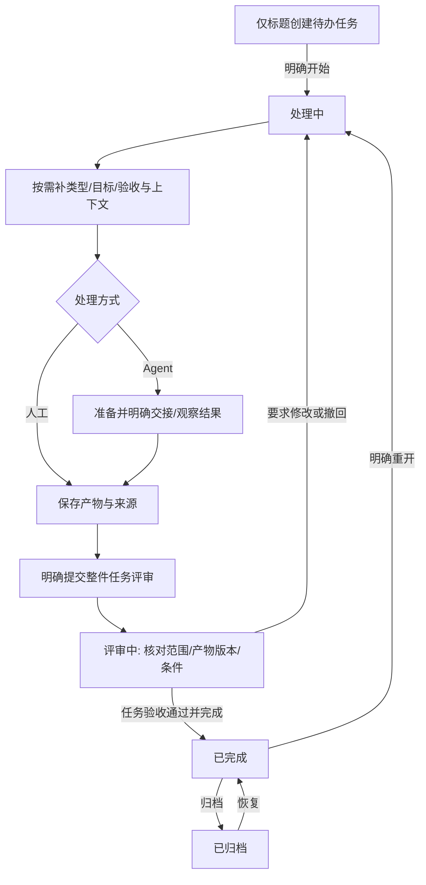

# Reed：业务操作流与一致性规则

<!-- markdownlint-disable MD029 -->

日期：2026-10-28（Asia/Shanghai）。状态：设计评审稿；本文描述拟实现业务，不是已运行的功能。

2026-10-30 更新：本稿采用任务类型独立、统一五状态、默认无流程和任务级验收；可选步骤与执行分别管理。共享前端已实现任务类型、五状态、可选流程、任务级评审及归档重开的本地模拟；其余操作规格与 Core 业务仍待实现，不能由模拟结果推导真实执行或同步通过。

2026-10-29 汇总：本文为独立 Reed 工程的现行业务设计，相关业务尚未实现。Core 统一执行规则，Tauri／宿主页面只是客户端；工程与运行机制以[架构总览](../architecture/overview.zh-CN.md)及专题文档为准。原始材料与哈希见[来源记录](../references/provenance.zh-CN.md)。

下文 StageRun/阶段仅指明确采用流程后的内部步骤；无流程的处理、产物和验收直接归 Task。

本稿细化[业务领域模型](domain-model.md)，与[交互设计](interaction.md)、[架构方案](../architecture/overview.zh-CN.md)配套。范围为操作、业务前置、事实变化、异常及恢复；不定义数据库、接口、代码或新增视觉方案。

## 1. 操作覆盖目录

| 流程 | 覆盖操作 | 主要业务结果 |
| --- | --- | --- |
| F01 | 新建项目、任务归组/移动、关联仓库和来源范围 | 组织关系与默认选择，不迁移既有执行 |
| F02 | 创建/编辑/发布模板、选用版本、配置推进规则 | 固定可采用的工作方法与自动化范围 |
| F03 | 本地新建、选/补类型、开始、重新排期、确认范围 | 待办/处理中及本轮范围依据，不强制流程 |
| F04 | 来源浏览、导入、重复导入、参考关联 | 唯一主导任务或显式参考关系 |
| F05 | 准备任务/可选步骤、按需准备目录/会话、保存/撤回准备 | 尚未执行的计划与准确交接目标 |
| F06 | 提交/预填、继续答复、观测结果、取消尝试、核查执行 | 准确执行归属及实际结果 |
| F07 | 登记/打开材料、人工提交、更新候选、复用成果 | 有来源、版本及适用范围的材料 |
| F08 | 任务级提交评审/撤回/要求修改/通过，内部步骤接受 | 任务验收与可选步骤结论分别明确 |
| F09 | 按类型处理、登记验证结果及后续处置 | 对准确交付对象的真实结果与目标达成判断 |
| F10 | 提出/采纳/放弃范围变更、同范围重开、迁移模板 | 新业务依据、替代轮次与材料复用决定 |
| F11 | 拆分、关联依赖、改变关系、登记子任务履约 | 独立任务及父任务的交付约定 |
| F12 | 暂停控制/恢复、完成后归档/恢复；任务级放弃待决 | 五状态流转，不假装已停止执行 |
| F13 | 关联/打开/解除会话或分支、Fork、重绑、漂移处理 | 可追溯关系，不转移活动执行 |
| F14 | 完成本轮、登记 PR/合并/发布、查看完成历史 | 明确版本的完成决定与独立交付事实 |
| F15 | 拉取来源更新、编辑来源字段、配置/采纳映射 | 保留基线与方向的业务变更 |
| F16 | 发送同步、撤回未发送意图、冲突处理、未知结果核查/处置 | 外部修改的可解释结果 |
| F17 | 解绑来源、交接主导任务、停用/重连、更换账号 | 不丢未决操作的协作关系变化 |
| F18 | 离线/重连、重复操作、并发更新、已读/关注、历史纠正 | 恢复权威事实和可继续处理的入口 |

每个流程的完成含义只限右列。保存不等于发送，发送不等于接纳，接纳不等于执行结束，执行结束不等于验收；归档、已读与外部同步分别有自己的结果。

## 2. 共同操作契约

### 2.1 参与者与业务决定

用户可以执行已允许的业务操作；确定性规则只能在用户明确启用的操作、项目/任务和条件内代办。Agent/LLM 可提供材料、关联或推进建议，不能以自己的完成描述产生授权。原生宿主和第三方来源提供观察事实，不能替代本地验收。

任何改变业务依据的操作都能说明：谁提出、针对哪个任务/轮次、采用哪些准确版本、需要哪些条件、已改变什么、尚待什么。拒绝和待核查也必须有明确结果，不用无限等待表示。

### 2.2 各操作复用的判断

| 判断 | 何时核对 | 不满足时 |
| --- | --- | --- |
| G1 对象与操作权 | 所有写操作 | 保留输入，说明只读/权限问题；关联链接不是授权 |
| G2 当前业务依据 | 确认范围、接受/完成、实际交接及外部发送前 | 版本已变则展示差异并重判，不对旧快照继续确认 |
| G3 任务推进控制 | 新阶段/尝试、新指令派发及本地自动推进前；既有答复另核对 F06 | 暂停不新派发，但准确既有交互可按 F06 答复且保持暂停；取消尝试待处置、归档/结束不放行新的受控继续；阻塞按必要条件，外部同步按 G6 |
| G4 输入与成果有效 | 本次操作、任务/步骤验收、复用和完成前 | 按实际操作缺项阻止推进；不因没有内部流程制造缺阶段 |
| G5 执行上下文及占用 | 任务/可选步骤的执行交接和重绑前 | 会话/目录不符或前序未收敛则等待、核查或另选允许目标 |
| G6 来源写入条件 | 生成/发送外部意图及交接主导前 | 身份、权限、主导、映射或同对象未决影响未明确时不写 |
| G7 重复与过期决定 | 重复提交、迟到观察、规则建议执行时 | 同一操作返回已有结果；过期或不同内容需重新决定，不能制造第二次副作用 |

准备时通过的检查不永久有效，真正交接或确认时仍按同一业务条件重新核对。这里要求的是已有业务约束的最终判定，不另造一套重复状态机或权限体系。

### 2.3 生命周期及操作矩阵

| 主状态 | 允许的主要操作 | 关键条件/后继状态 |
| --- | --- | --- |
| 待办 | 补类型/上下文、开始处理；已有成果可明确开始并提交 | 基本目标明确→处理中；组合提交须满足 F08→评审中，不启动 Agent |
| 处理中 | 人工/Agent 处理、补资料、登记产物、提交评审、重新排期 | 提交满足 F08→评审中；无活动/未知执行可退回待办，保留成果 |
| 评审中 | 审阅、撤回、要求修改、通过并完成 | 固定任务范围和产物；修改/撤回→处理中，通过满足 F14→已完成 |
| 已完成 | 查依据/历史、明确重开、归档 | 重开→处理中；归档满足 F12→已归档 |
| 已归档 | 查看历史、恢复 | 恢复→已完成；继续工作再明确重开，不自动派发 |

日常看板前四列，归档为历史入口；类型、可选内部步骤、执行和来源状态均不替代主状态。直接 CLI/插件/拖拽/规则同样受上述动作条件约束，不提供无条件设置状态。

暂停和阻塞是推进控制。显示主状态并附原因，限制相关操作；不因暂停假装原生进程停止。暂停中可登记准确结果及原 Attempt 的有效答复，不解除暂停或新派发。取消尝试请求未收敛时不受控继续同一尝试，先核查其实际终态。

已完成/归档仍可独立核查原执行和外部意图。G3 管本地新派发，G6 管来源操作；外部不可用不冻结全部本地工作，归档不隐藏未决同步入口。任务级取消/放弃的终态尚待决定，当前不以取消状态或归档代替任务未完成的事实。

## 3. 端到端本地主线

默认没有内部流程；选用模板时，处理中可展开其步骤，内部接受仍不自动完成 Task。
直接路径不创建空 StageRun。产物可以已有并人工提交，明确组合“开始并提交”时核对同一组条件，不强迫先运行 Agent。
外部关联与写入是 F15–F17 的后续独立能力，不成为上述本地闭环的前提。

## 4. 建立工作与业务依据

### F01 项目、归组与资源范围

**前置**：用户选择本地工作范围；新建任务不要求先配置项目、仓库或云效。

1. 新建 Reed 项目，填写组织用途，可选择候选仓库及来源项目范围。
2. 创建/移动任务到项目，预览原关联和新默认配置；保存组织关系。
3. 新默认模板、仓库、映射仅作为后续选择；已有轮次、会话、工作区、范围及主回写目标保持原业务依据。
4. 如需采用新的输入、模板或来源目标，分别进入 F10/F17，不在归组动作里偷偷迁移。

**失败/恢复**：仓库或来源不可访问时保留项目与现有任务，标明候选不可用；不把查不到当作已删除。解除项目归组保留 Task 和历史；首版不提供物理删除已保存业务历史的捷径。

### F02 可选模板与推进规则

**前置**：用户明确需要内部步骤。默认无流程；任务类型只提供推荐，不自动绑定模板。

1. 编辑模板草稿：步骤稳定标识、顺序、方式、前置、产物、内部确认及允许跳过/返工规则。
2. 核对必要条件可判定且无阻断环，区分内部步骤接受与整件任务的验收责任。
3. 发布固定版本，任务明确选用后才建立流程轮次/步骤；未选流程仍可直接处理、评审和完成。
4. 推荐的研发四阶段仅为一个可选模板，文档、测试、需求等任务没有统一四阶段前置。
5. 自动化仅在明确启用的操作/目标范围内代办；任务级提交和接受不能由最后一步结束隐式产生。
6. 更换/移除已采用流程按 F10 预览必要工作及证据影响，不靠改无流程绕过已承诺条件。

**失败/恢复**：模板草稿有缺项可继续编辑；没有模板不等于任务不可用。停止自动化只停止新决定，不伪装已发执行/同步停止。

### F03 本地创建、开始处理、重新排期与范围

**前置**：标题有效即可创建；类型/项目/仓库/资料可后补。

1. 保存本地 Task、草稿及可选关联，进入待办；类型未选为未分类，默认无流程。任务说明和参考资料不自动成为验收产物。
2. 用户点击开始处理后进入处理中，再选择人工整理或 Agent 协助。开始不启动 Agent，不强制仓库或完整范围。
3. 根据实际操作补本次输入与资源。允许从草稿澄清目标；有副作用的执行先明确其范围/权限，提交任务评审前采用明确的目标和验收条件。
4. 确认范围形成 V1；有流程才关联实际流程/步骤。内部需求确认（若存在）不替代任务级完成。
5. 处理中明确退回待办须无运行、等待答复或未知执行；先处置并确认真实结束，再重新排期。原成果、已确认步骤和历史全部保留。

**失败/恢复**：保存失败保留输入；回执丢失先查原创建结果，不重复新建。草稿变化只形成候选，已采纳范围变化走 F10。新任务不因没有模板、仓库或资料显示失败；缺项只阻止依赖它的具体操作。

### F04 来源浏览、导入与参考关联

**前置**：来源连接可准确识别账号、实例/组织及业务对象，有相应读取权限。

1. 按用户指定项目/条件浏览，失败显示不可用；浏览不建立 Task。
2. 选择对象，预览原始类型/状态、本地类型/状态候选、可选模板和「主导导入／仅参考已有任务」用途。
3. 最终导入时重新检查准确外部身份及已有主导任务；多端同时导入返回同一个已建立主任务。
4. 没有主导时建立本地待办 Task/草稿与关联，原始状态只保留为来源事实；映射候选仍走本地条件，不能直接导入已完成；已有主导时打开已有任务，派生工作需显式新建并仅关联参考。
5. 外部父子关系保留为来源事实；创建本地拆分需另走 F11。

**失败/恢复**：读取中断可重新读取；保存中断先核对导入结果。对已解绑历史项重导入时展示历史任务和未决操作，由用户选择复联/新建；不借新建主导绕开旧在途写入。只读导入不证明具备写权限，也不立刻回写状态。

## 5. 从准备到执行结果

### F05 任务/可选步骤准备、资源准备与撤回

**前置**：当前任务/轮次允许此操作，上游采用版本及必要依赖明确。

只查看/保存计划草稿与开始新的资源准备分开；后者和新的阶段工作、最终交接均须满足相应推进控制，不能在推进暂停控制生效时偷偷准备并派发。

1. 选择 Task 本次目标、材料与允许路径；有流程才补充当前步骤，保存处理准备；准备是计划，不是已发送的执行。
2. 按操作选择所需执行/产出位置；涉及代码才选择/复用代码工作区，需要创建时预览仓库、基线、分支和目录，再显式准备。多仓库逐项显示结果；非代码文件写入明确实际目录及允许范围，不强制 Git 仓库或 worktree。
3. 保留已创建资源的归属；部分失败可继续未完成步骤，不覆盖未知目录，不自动删除已完成部分。
4. Agent 路径选择宿主及准确会话，按实际能力核对执行目录；涉及代码再核对仓库/分支。人工处理不强制宿主会话；不能把旧会话提示词中的路径当作迁移。
5. 全部就绪后展示输入预览与该端真实动作：直接交接、打开预填或人工导航；最终交接进入 F06。
6. 保存准备不派发。撤回未交接准备只关闭计划，保留已创建目录及草稿；资源清理另行处理。

**失败/恢复**：材料变化则准备待复核；会话忙于其他任务则等待或另选允许目标。已交接或是否发送不明的准备不能以关面板当作撤回，转 F06 核查后处置；未知执行不解占用。

处理准备归属 Task；实际采用步骤时才有 StageRun，可以没有 AgentAttempt。仓库/环境/工作区需求由操作能力决定，不按固定阶段序号。进入可追踪的 Agent 交接时建立 Attempt 并固定实际输入；准备创建工作区的结果可以独立保留，不伪造 Agent 已启动。

### F06 原生交接、等待答复、终态与取消尝试

**前置**：F05 已准备；最终动作重新满足 G2–G5/G7，宿主能力已验证。推进暂停或取消尝试请求到达后不新派发；暂停中的准确有效答复按第 4 步，取消尝试待处置不适用该例外。

1. 固定本次输入和交接范围，建立准确 Attempt；同一 Task 处理目标/可选 StageRun 的前序尝试未收敛时不接受普通重试。
2. 直接提交端登记交接后发送；只记发送中，准确接纳证据到达才记已接纳，开始证据到达才记执行中。
3. 仅预填端记「待用户发送」；用户实际发送、身份/输入/目录核对及回执关联成功后再推进。纯导航端只记导航，不假称执行。
4. 用户答复已接纳 Attempt 的准确有效交互时，核对原目标/输入/交互实例、有效期和当前授权，可继续该 Attempt；暂停中也允许，但不解除暂停、不扩范围或自动派发后续阶段。取消该尝试待处置、归档/结束或交互失效时不经 Reed 受控答复；无可靠关联/回复能力则回原宿主手动处理并单独观察，不承诺拦截原生手动发送。未经关联的轮次不能猜成本任务执行。
5. 准确结束后登记实际结果和产物引用，转 F07/F08；终态先于开始/接纳观察到达时保留并核对，不等待缺失事件无限卡住。
6. 取消尝试先记录取消请求，再核对宿主结果；实际可能完成、失败或取消，均保留真实结果。
7. 只有准确执行及相关受管理写入确认停止后释放会话/工作区占用；预览环境可独立保留。

**失败/恢复**：确定未提交才允许安全重试；交接回执丢失、预填后是否发送不明或宿主失联进入结果核查，不重发。已向宿主预填而要撤回时须核对发送情况及交接失效，不能只删本地记录；Reed 不宣称能阻止用户在原生界面手动发送。

无法确认停止时保留原记录并核查；如需继续工作，明确替代 Task 当前处理上下文，有流程时再替代受影响步骤。选择独立会话，涉及代码写入时使用独立工作区并核对基线；非代码任务不强制创建代码目录。旧执行仍可见，不能作为原 Task 处理目标/StageRun 的普通重试，也不能借换上下文释放原资源；任务最终完成仍要处置妨碍成果/资源安全的未决执行。

### F07 产物登记、人工提交、更新候选及复用

**前置**：知道材料来源、适用任务/可选步骤和准确版本；拥有该材料的访问范围。

1. 登记文件/外链或接收 Agent 产物，核对可访问内容、位置及来源，形成 ArtifactVersion 或明确的引用快照。
2. 人工完成/修订时登记 ManualSubmission 和材料版本；不生成虚假的 Agent/工具运行成功。
3. 新内容形成新候选版本；不会替换已接受输入。可查看、比较、打开原文，缺失时保留历史并写明不可核查。
4. 复用旧材料时展示原来源、版本、当前输入差异、必要证据及接受标准，逐项判为「本轮接受复用／补证／重做」。
5. 本轮复用登记新的适用/接受依据，保留原生产者；验证代码对象不同不得复用旧通过结论。

**失败/恢复**：缺失或越界材料不算有效成果；用户可重新定位/补交，不删除旧接受。在线资料未取离线快照时明确访问限制。登记、已读、下载或生成文档不等于验收。

## 6. 验收、返工与完成

### F08 任务级评审与内部步骤接受

**前置按动作区分**：提交整件任务评审从处理中发起；待办已有完整成果时可明确组合“开始并提交”。提交须固定目标、范围和验收条件，必要实际工作/产物/来源/证据齐备，可能改写这些成果的执行已确知结束。审阅、撤回、要求修改和通过针对评审中任务的准确提交；内部步骤接受针对实际存在的步骤及其允许操作，不统一要求 Task 处于处理中。无流程直接关联 Task，不要求 StageRun。

1. 提交整件任务评审时冻结被审范围和成果，进入评审中。已有完整材料可明确组合“开始并提交”，核对相同条件。
2. 展示类型/目标/条件、产物版本、来源、真实结果和证据缺项；查看不接受。
3. 要求修改/撤回均回到处理中，记录原因和原提交；新版本再次提交。评审中不悄悄改写被审版本。
4. 通过时重新核对当前版本和 F14 全部任务完成条件；明确“通过并完成”形成任务级 Acceptance/CompletionDecision，进入已完成。
5. 可选流程内部步骤接受单独说明对象与版本；Task 仍可在处理中，最后一步通过不隐式置整件任务评审/完成。
6. 步骤证据可直接用于任务级审阅，不强制重复审批同份材料。必要实际工作已完成、仅待内部人工确认时，可将步骤接受与任务级评审明确组合；必须明示两种意图且分别满足条件，不能以待确认掩盖未做工作。已完成/已归档任务若需返工，先按 F10 重开。
7. 内部跳过按已采用规则处理；放弃已承诺的验收条件须范围变更。纠正误判保留历史，重判本轮适用性和后续意图。

**失败/恢复**：材料/目标变化时保留差异并拒绝接受旧版本。缺失证据、仍有可能改写产物的执行或结果未知时，保持原状态并指明处理入口。Agent 结束、已读、生成报告都不自动提交任务评审或形成通过。

### F09 不同类型的处理与验证结果

**前置**：任务类型/目标和当前范围可识别，执行所需资料及环境按实际操作补齐。

| 类型路径 | 处理与产物 | 评审/完成判断 |
| --- | --- | --- |
| 需求 | 澄清问题、边界、目标和需求说明 | 需求任务自身的约定满足即可完成，不再强制进入开发 |
| 开发 | 准备约定仓库/目录，实现变更，记录代码对象与自检 | 按开发交付约定验收；不从 Agent 退出推导完成 |
| 测试 | 按计划执行测试、记录覆盖/结果/缺陷 | “执行并报告”目标可接受含缺陷的完整报告；若约定全通过则继续处理失败项 |
| 验证 | 固定待验证对象/版本、方法/环境，形成证据和结论 | 按约定判断正向或负向结论是否满足任务目标，不涂改失败为通过 |
| 文档 | 人工或 Agent 编写/维护文档，固定评审版本 | 审稿满足要求即可完成，不强制走研发四阶段 |

无分类任务使用通用目标、产物和验收条件。类型改变不改变生命周期，也不能绕过已有承诺。推荐模板只有明确选用才产生内部步骤。

代码相关任务固定所用快照与覆盖范围；代码从 C1 改到 C2，C1 结果保留但不冒充对 C2 的结论。按实际影响重新处理/验证，选用流程才定位相应步骤；多仓库按约定逐项核对。环境失败如实记录，不计为已执行的成功验证。每项必要验收条件须按已采纳约定满足；目标要求执行指定计划时，未运行/环境失败报告不能代替约定执行覆盖，减少覆盖承诺须先走 F10。

### F10 新候选、采用新版、范围变更、重开与模板迁移

**前置**：明确变更意图及影响范围。保存候选或不改变被审依据的展示整理不要求重开；采用影响范围、验收条件、类型规则、模板或成果的变更时，评审中先撤回到处理中，已完成先明确重开，已归档先恢复到已完成再重开。可提供明示的“撤回并采用”组合操作，最终停留处理中，不自动重新提交或通过；每个动作均核对当前状态/版本，保留撤回原因与原提交/决定。旧证据实际失效另按下文复核，不隐式改变主状态。

1. 保存候选/建议，展示相对当前采用版本的差异；放弃候选不影响原接受依据。
2. 确定采用前检查 Task 状态、旧执行、必要子交付及待发外部意图，选择下列业务动作。

| 采用情形 | 当前业务依据怎样变化 | 当前工作点及保留事实 |
| --- | --- | --- |
| 新候选未采用 | 不变 | 原接受输入继续有效，不因新文件存在而回退 |
| 同范围采用新的上游输入 | 重判任务成果；有流程才重开受影响 StageRun | 回到/保持处理中，原产物/下游历史保留，停止过期准备 |
| 已采纳范围实质变化 | 固化新范围，有流程才建立替代流程轮次 | 逐项判断旧材料复用；原执行仍需处置 |
| 已完成任务按同范围继续 | 明确重开到处理中，记录本轮起点；有流程才新建流程轮次 | 原完成与范围保留，旧关闭意图重判 |
| 采用/更换/移除可选流程 | 预览必要工作、条件和材料变化后明确采用 | 无空流程或自动通过；暂停控制保留，完成/归档须先明确重开 |

3. 对新轮次逐项确认复用、补证、重做，不能直接克隆通过标记；若新模板改变业务验收承诺，还要形成范围变更。
4. 旧业务轮次被替代但旧 Attempt 继续按原归属收敛；旧目录不可抢占，迟到成果不能覆盖新轮次。
5. 当前未发送、基于本地结果的关闭等意图按原完成决定是否仍适用重判；直接外部编辑按自己的决定及当前上下文判断。已经发送的操作保留原含义并核查，不假称撤回。

**失败/恢复**：未确认迁移前不改当前轮次。处理中任务按新条件重判，暂停控制保留；已归档先恢复到已完成，完成任务不因编辑或模板发布隐式重开。无法自动判断的影响留待处理，不把模型置信度当采用决定。

已接受证据实际丢失/变化即使没有采用新候选，也会触发依赖复核。有流程时定位最早受影响步骤，无流程直接定位任务成果；已完成/已归档保留主状态和历史完成，并标明“完成依据待复核”，旧关闭不能继续以此为有效依据。归档或恢复不消除提示；需要补做、换成果版本或改范围时，仍须先恢复/明确重开。

若只是重新定位并核实原准确证据，且原范围、条件、成果版本及验收对象未变，可记录适用性核查，确认满足后恢复有效提示；不新增验收或隐式重开。核查不能补足原来未满足的条件、修正原验收误判或把旧快照冒充当前现场，这些情况先明确重开并重新评审。核查本身不新建或重发关闭意图，尚未取消的原待发/未知意图按 F15–F17 独立判断，已取消/被替代的意图不能自动复活。

已固定且仍可读取的旧文档版本，不因外部路径出现另一候选就自动失效。若声明验收对象是当前工作区，则工作区代码变化会使旧验证不能代表当前对象；需要明确回到原快照或验证新快照，不能以「尚未采用」掩盖代码漂移。

### F11 拆分、依赖及履约变更

**前置**：明确父任务交付约定或阶段前置，而不是仅为了列表分组。

1. 创建具有独立目标和生命周期的子 Task；模板仍可选。拆分单父且无环，普通关联不创建父子关系。
2. 标明必要/可选交付及父任务的集成验收责任；必要子范围确认后绑定准确版本和符合既定约定的成果。
3. 新增依赖时说明阻断的是开始、验收或完成，以及所需准确结果；检查所有必要关系合成后是否存在相互等待。
4. 移动、替换、移除必要子任务或依赖前预览对已采纳约定的影响：履约重绑且约定不变可直接登记，改变必要性/边界/标准走 F10。
5. 子任务按自身类型/目标独立验收；父任务确认约定成果才履约。归档不撤销已接受履约，也不能补出未确认履约；未完成/放弃不能冒充通过。

**失败/恢复**：P 等待必要子任务 C，而 C 又要求 P 完成，必须拒绝这个混合阻断环。已完成子任务后续扩展新范围不自动撤销旧履约；原约定证据失效则复核相应父结论，不能冻结所有无关任务。

### F12 推进控制、归档与恢复

**前置**：显示任务主状态、相关执行/准备和独立未决事项，动作不隐含资源删除。

| 动作 | 业务步骤与结果 |
| --- | --- |
| 暂停处理 | 保留任务主状态，明确阻止新派发；接收原执行结果及允许的准确交互，不假装执行已停止 |
| 恢复处理 | 解除控制后重判输入/依赖/占用，保留仍存在的阻塞，不重启旧尝试 |
| 归档 | 仅已完成任务可进入已归档；检查妨碍本地成果/资源安全的未决执行，保留完成决定、类型、关系和历史 |
| 恢复归档 | 回到已完成，保留证据适用性提示；继续工作须另行 F10 重开到处理中 |
| 未完成任务尝试归档 | 拒绝，保留原状态；不能用收纳动作制造完成或放弃结论 |
| 任务级取消/放弃 | 本轮语义待确认，不新增终态或开放操作；不得映射成已完成/已归档 |

取消某次 Agent 尝试仍按 F06 核查实际终态，原 Attempt 自然完成/失败不改变任务验收。归档不删除文件、分支、会话，不释放未知占用，也不级联改变子任务。

归档不撤销外部同步；其授权、当前依据和核查按 F15–F17 独立判断，未决同步仍在全局待处理可见。归档恢复不会重新触发外部关闭、Agent 或 Git 操作。

### F13 会话、分支与工作区关联操作

**前置**：区分历史参考、可导航引用、当前执行目标，以及真实存在的仓库/工作区。

1. 从任务或资源视图选择准确对象，显示已关联任务/用途、宿主或仓库及最后观察事实。
2. 参考关联只登记关系；要用作执行目标，另走 F05/F06 核对身份/目录及占用。
3. 打开原生会话、文档或目录分别报告实际导航结果；选中列表、切视图不产生 checkout 或发送。
4. Fork/新建会话产生新引用，历史继承关系可见，控制权限和目录不继承；重新绑定不转移活动 Attempt。
5. 解除历史关联保留产生过的执行和证据来源；当前执行绑定必须先停止/核查，不能直接改绑给另一 Task。
6. 目录、分支或身份漂移时并列显示期望与实际；失效当前准备，重新定位/关联后再判可执行。

**失败/恢复**：链接仅能导航、宿主不支持枚举/跳转时说明能力限制，不猜最近会话。删除后同名分支不自动接管旧历史。清理工作区须另行确认归属、停止和需保留修改；首版不提供强制删除捷径。

### F14 完成本轮及交付记录

**前置按动作区分**：查看范围、缺项或历史只需对应读取权限，不要求先满足完成条件。“通过并完成”仅针对评审中任务，须满足领域模型 §9 的全部完成条件，只有选用流程才检查其必要步骤。登记交付依据准确操作/观察及其权限，不以 Task 已完成为前提。

1. 展示本轮范围、成果、验证、复用/跳过依据、必要子任务和交付条件，指出未满足事项。
2. 在任务评审中明确通过并完成，固定 Task、范围、条件、产物/证据及任务级决定；流程引用可选。内部步骤接受或进度百分比不能代替该决定。
3. 新完成决定若触发已生效映射，再形成对应待发外部意图；查看历史/恢复归档不重新生成，仍不显示外部已完成/已同步。
4. PR/MR、合并或发布由明确操作/观察登记其准确代码和来源；这些事实不自动完成 Task，也不因 Task 完成触发 Git/部署动作。
5. 后续结论失效按 F10 标明当前适用性；查看完成历史不重新触发规则或创建第二条关闭意图。

**失败/恢复**：任一依据变动，保留审阅页面并重判；本地完成保存结果不明先核对已有决定。云效失败或未知不撤销本地完成；若项目要求上线，未取得规定发布证据时不能完成。

## 7. 外部双向协作与恢复

### F15 拉取、编辑外部字段与采用映射

**前置**：准确来源对象、连接主体和字段归属已知；本地范围与外部原文不是一份可随意互相覆盖的文本。

1. 拉取并记录远端观察及时间，与共同基线、本地期望比较。列表中消失/单次不可访问先标待核查，不级联删除 Task。
2. 未涉及本地编辑的外部字段可更新观察；远端实质需求变化先形成待采用建议，不改本地已接受范围。
3. 用户编辑允许的外部字段后，本地保存期望及相应同步意图；字段同时被双方改动则显示差异，不整条覆盖。
4. 主导任务、有效映射、操作授权和真实写权限共同决定是否可发；可选状态仅为候选，服务端可能拒绝流转。
5. 映射指定来源/项目/类型、工作流版本、方向、触发及目标含义；发布新版本不改写在途意图，待发项需明确重判/替代。
6. 采纳/拒绝 LLM 建议必须核对当前版本和作用范围；建议过期即失效，不用高置信度绕过检查。
7. 已确认写入的回流只更新观察及基线，不把同一业务决定重新变成一次本地变更或重复回写。相同来源事件、决定与映射重复到达时复用已有结果；新的实质来源变化再形成新建议，不能自动写回旧范围。

**失败/恢复**：拒绝远端变更建议只表示不改本地范围，仍保留最新来源观察和差异；不因此自动把旧范围写回远端。撤回未发同步时明确本地编辑保留或放弃，不回滚已接受范围和材料。

直接编辑外部状态时，预览明确写「仅修改来源状态，本地阶段/验收保持原事实」，确认后形成独立外部操作决定。它不要求本地 Task 已完成，也不免除 G6；按本地完成自动关闭的规则则必须引用有效完成决定，不能借这个手动入口绕过条件。

首版提交直接外部字段编辑时，在预览中明确该字段的自动映射将暂停；同字段尚未发送的规则意图重判撤回/替代，已发送的先核查。后续阶段事件可以形成建议，但不能静默覆盖手动期望。恢复自动映射时预览当前会写什么；放弃未发手动编辑也要说明是否恢复原映射，不能借此重放旧意图。暂停只作用于该主关联的相应字段，不冻结本地工作或其他字段。

### F16 发送、确认、冲突与未知结果处置

**前置**：最终发送重新核对 G2/G6/G7；同一远端对象按已有顺序处理，跨连接不能绕过未决影响。

1. 将本地期望、基线、字段、主体、映射及相关业务决定固定为一条意图；只有未发意图可按明确规则合并/撤回。发送期间的新编辑属于后继期望，不能改写在途正文；旧回执不覆盖后来的本地期望。
2. 发送前核对远端当前值与具体业务依据。阶段接受触发的推进引用准确 Acceptance、StageRun/输入/产物及映射版本；接受更正或输入失效时重判未发意图。所有规则自动关闭/完成类写入必须另引用有效 CompletionDecision，不能仅凭阶段接受绕过任务完成；同范围重开也使其不适用；直接编辑引用自己的明确决定，不冒称本地已完成。已发调用含义不改，继续核查。
3. 明确冲突则保存差异并暂停后续依赖写入；明确无发送/明确拒绝则保存原因，按允许方式修正或重试。
4. 已发送结果按下表处理，不能让一个成功提示覆盖全部字段/操作。

| 观察结果 | 业务结论与后续 |
| --- | --- |
| 可准确关联成功且回读符合 | 记录请求结果及新基线；没有其他待发/冲突/未知才展示相应范围已同步 |
| 成功响应但回读不符 | 保存异值/冲突并核查，不直接显示同步成功 |
| 超时、回执丢失或发送后本地中断 | 原意图结果未知；先核查，不以普通重试再发 |
| 仅看见远端值已等于期望 | 记录当前值一致；不足以证明原请求或迟到影响结束，不单凭此释放队列 |
| 已核查终态及影响 | 基于新的远端观察重算后续期望，不重放旧请求正文 |

5. 冲突处理逐字段选择保留/合并/放弃，预览新期望及基线后形成新意图，旧记录保留。
6. 无法核查的未知结果提供三条出口：保留该对象写入暂停、解绑并保留未决记录、或用户明确接受残余迟到风险后形成独立人工处置决定；不把原操作改成已确认。
7. 人工处置说明输入快照、操作范围及是否放行队列；迟到结果归原意图并重新检查后继漂移，不伪造当时已成功。

**失败/恢复**：同一对象后续依赖写入仍受未决占用影响，其他对象和本地任务可继续。账号/权限失效按 F17 重连；建单、评论等追加副作用必须在专门能力验收后启用，不能复用字段覆盖的重试假设。

**远端并发保证界限**：发送前读取和发送后回读不是原子防覆盖。读取基线 X 后，远端用户可能先改为 Y，本次写 Z 再覆盖 Y；若来源没有已证实的条件更新能力，回读 Z 也未必能发现这次覆盖。首版只能按实际接口能力声明保证，不承诺严格一致或恰好一次；若项目要求严格避免此类覆盖而连接器不能证明满足，则阻止相应自动/直接写入，保留只读或变更建议。是否具备条件写入、通知副作用及核查能力，留待真实来源接口验收，不从本地串行推导。

### F17 解绑、主导交接与账号变化

**前置**：展示来源关系、主导归属、待发/在途/未知操作及其原主体；参考关系和回写关系分别处理。

1. 解除参考关联只改当前关系，历史输入和来源证据保留；主回写解绑同时撤回未发送意图，已发送/未知继续记录及核查。
2. 原始外部对象和未决影响不因解绑消失；重新关联、重导入、新账号都不能绕过同对象写入限制。复联时展示并保留历史手动字段的映射暂停；只有预览「当前会写什么」并由用户明确恢复后才重新启用，不能仅展示历史就默认清除暂停。
3. 主导交接须核对新任务是否已有主目标、是否承担完整外部交付约定及必要贡献者；旧待发意图撤回，新任务明确采用基线和映射，决定保留或恢复已有手动字段暂停，不能直接继承原请求或默认恢复自动覆盖。
4. 旧在途影响未确认时，仅保留参考关联，不能直接接管可写主导；经核查或 F16 明确处置后再决定，实际写入仍需新主体授权。
5. 同主体凭据刷新经核验后可恢复连接；更换主体/组织建立新连接，旧意图不迁移。
6. 停用连接停止新的网络访问与派发；不能撤销已发请求，保留结果及原主体引用。重新获得对应合法访问后继续核查；凭据处理不删除业务历史。

**失败/恢复**：新账号即使也有项目权限，也不替旧账号发意图。主导交接预览未确认或条件变化时保持原归属；本地 Task 不因解绑/来源删除而取消或删除。

## 8. 重复、离线、并发与注意力

### F18 观察恢复与用户继续处理

**前置**：知道当前投影和最近观察时间；恢复不以页面缓存替代本地权威事实。

1. 本地服务不可用时，已有投影标明时间并只读；可保留未提交草稿，不能提示已保存或已发送。
2. 宿主失联时，Task 与活动执行仍存在；重连先按准确原生身份核查，旧执行未明确前不派发替代尝试到同一资源。
3. 重复动作返回该次业务决定/操作的已有结果；不知道是否已发送时核查，不由页面刷新创建第二次执行。
4. 另一端已改动当前依据时，保留输入和差异，重新基线后决定；迟到结果归历史，不覆盖新范围或新期望。
5. 待我处理按任务去重，事项指向准确任务/可选步骤、来源或资源；标已读仅清注意力，问题是否解决按原业务事实判断。
6. 来源不可用、同步未知、当前执行未知分别呈现；不能将它们都归为任务已失败或全部流程被阻塞。

**失败/恢复**：核查不能取得事实时保留明确待处理入口，不用猜测补齐；人工更正记录新增依据，不删除原观察或改变历史当时含义。

## 9. 操作后应该显示什么

| 操作结束时 | 正确反馈 | 后续入口 |
| --- | --- | --- |
| 创建成功 | 已创建，待办；类型/项目可后补 | 开始处理、完善信息 |
| 开始处理 | 处理中，尚未启动 Agent | 人工处理或单独准备执行 |
| 保存说明/参考资料 | 已保存上下文，不代表阶段产物/验收 | 继续处理 |
| 采用范围/可选流程 | 明确本轮依据，展示实际必要工作 | 准备实际操作，不自动派发 |
| Agent 结束 | 已确认实际结果，Task 仍按本地生命周期；产物可登记 | 补齐/提交整件任务评审 |
| 内部步骤接受 | 步骤已接受，整件任务尚未验收 | 继续必要工作或明确提交任务评审 |
| 提交评审 | 评审中，显示被审范围和版本 | 通过并完成、要求修改/撤回 |
| 通过并完成 | 本轮 Task 已完成，交付/同步另列 | 查看依据、归档或明确重开 |
| 归档后恢复 | 已完成，原有完成依据待复核提示保留，不自动启动工作 | 核查原依据、查看历史或明确重开 |
| 结果/同步未知 | 各自待核查，不能伪造通过或已确认 | 准确核查与后续处置 |

## 10. 设计走查矩阵

下表是基于业务规则的静态场景走查，尚未运行实现测试。

| 编号 | 可达操作序列 | 必须保持的结果 | 对应流程 |
| --- | --- | --- | --- |
| W01 | 仅标题创建并开始、补齐材料后提交任务评审 | 创建待办/开始处理中；提交时固定目标/条件，不强制需求阶段 | F03/F05/F08 |
| W02 | 无模板的开发/文档任务直接人工处理；无仓库的文档 Agent 准备 | 不创建空阶段；人工无宿主要求，非代码按需核对产出位置而非强制工作树；任务验收正常完成 | F02/F03/F05/F09 |
| W03 | 两端同时导入同一外部项 | 同一主任务，主导不重复 | F04 |
| W04 | 工作区就绪但当前会话在旧目录 | 不发送，显示接入路径 | F05/F06 |
| W05 | 准备后暂停再发新指令；既有 Attempt 等答复后暂停再答复；取消尝试中答复 | 新派发拒绝；准确既有交互可答复且暂停控制保留；取消尝试待处置不放行受控继续 | F06/F12 |
| W06 | 预填后是否已发送无法确认 | 核查而非再次发送或简单撤回 | F06 |
| W07 | 请求取消后先到自然完成 | 记录 Attempt 实际完成，Task 不自动完成 | F06/F12 |
| W08 | 执行终态早于接纳/开始观测 | 准确核对后收敛，不永久等待 | F06 |
| W09 | 推进暂停期间材料到达/内部接受 | 暂停控制保留，不新派发；任务级评审另核对 F08/F14 | F08/F12 |
| W10 | 未完成任务尝试归档，随后依赖满足 | 拒绝归档，仍按原状态处理，不假完成/放弃 | F12 |
| W11 | 完成→归档→原证据丢失/不可核查→恢复；随后定位原证据或继续工作 | 主状态依次已完成/已归档/已归档/已完成，待复核提示保留；原依据不变可核查适用性，补做/换版本须显式重开，不隐式触发执行或新关闭 | F10/F12/F14 |
| W12 | 已完成/已归档任务仅编辑或迁移模板 | 不能隐式重开；重开迁移有独立决定 | F10 |
| W13 | 新设计候选存在但未采用 | 原接受输入不变 | F07/F10 |
| W14 | 采用新设计或旧证据确实失效 | 有流程定位受影响步骤，无流程定位任务成果；历史完成保留且标依据待复核，不作为当前有效通过 | F08/F10 |
| W15 | Agent 草稿由人工修订 | 记新候选来源，不免除必需验证 | F07/F08 |
| W16 | 验证 C1 后代码变 C2 | C1 结果保留，C2 不沿用通过 | F09 |
| W17 | 同名阶段迁移并复用旧材料 | 逐项核对标准与证据，不复制通过标记 | F10 |
| W18 | 父必要交付替换/移除 | 不作为整理偷偷改范围 | F11 |
| W19 | P 等子任务 C，C 又等 P 完成 | 拒绝合成的必要阻断环 | F11 |
| W20 | 子任务归档或新扩 V2，父约定为 V1 | 按原履约和真实证据判断，不盲追最新 | F11 |
| W21 | 同范围重开而旧关闭尚未发送 | 旧完成依据失效，关闭撤回/替代 | F10/F16 |
| W22 | 旧关闭已发送后重开，结果迟到 | 原意图核查，不能覆盖新期望 | F10/F16 |
| W23 | 远端当前值一致但旧请求未知 | 不据此释放该对象后续写入 | F16 |
| W24 | 解绑未知操作后以新连接重导入 | 不能绕过原外部对象未决影响 | F17 |
| W25 | 主导交接到已有主目标/范围不全的子任务 | 拒绝接管，保留参考关系或明确重定约定 | F17 |
| W26 | 归档任务仍有未知同步 | 全局待处理可见，不丢未决历史 | F12/F16 |
| W27 | 仅标已读或打开原生会话 | 不改变验收、取消或同步占用 | F13/F18 |
| W28 | 服务断开时保存/发送，恢复后重复点击 | 说明未确认，先核对已有结果，不假成功 | F18 |
| W29 | 本地决定写云效后回流/重收事件；阶段接受生成待发意图后更正接受/输入失效 | 同一决定不回环；阶段意图准确引用 Acceptance，失效未发意图重判，已发只核查，不伪造 Task 完成 | F08/F15/F16 |
| W30 | 标题 A 正在发送时本地又编辑为 B，A 回执迟到 | A 只更新其结果，B 仍是后继期望，不能被覆盖 | F16/F18 |
| W31 | Task 已完成/归档，仍有基于有效完成决定的关闭或核查 | G6 独立判断，不被 Agent 派发禁令误挡，也不因归档无条件放行 | F12/F14/F16 |
| W32 | 前置读取后远端并发改同字段，来源无原子条件写证明 | 不声称回读可严格防覆盖；按项目保证要求限制对应写入能力 | F16 |
| W33 | 本地验证未结束，用户明确编辑云效状态为完成 | 按独立外部决定及 G6 判定可否写入，本地仍未验收；自动完成规则不得借此绕过 | F15/F16 |
| W34 | 用户手动修改来源状态后，下个阶段事件产生自动映射 | 该字段自动映射暂停，展示建议而非覆盖；明确恢复时预览当前期望 | F15/F16 |
| W35 | 手动字段已确认、无未决写入，解绑后重新主关联 | 仍保留字段映射暂停；只有预览当前期望后明确恢复，不能因没有未决队列而自动启用 | F17 |
| W36 | 五种类型分别经待办/处理中/评审中/完成 | 同一生命周期，产物和验收按目标不同，不要求每件任务四阶段 | F03/F08/F09/F14 |
| W37 | 待办文档任务已有完整材料，明确开始并提交，再次打开评审后通过/要求修改 | 相同提交门槛进入评审中；无 Agent/无仓库/无模板也能通过完成或退回处理中，后续仅完成可归档 | F03/F07/F08/F12 |
| W38 | 测试报告含失败用例，或环境失败导致计划未执行 | 失败用例按“执行并报告”/“必须全绿”分别验收；要求的执行覆盖未完成时不能仅凭报告完成，不修改真实结果或暗减条件 | F09/F14 |
| W39 | 可选流程最后步骤接受；必要工作已做，仅待内部确认时提交任务评审 | 不隐式提交/完成整件任务；可复用证据并明示组合确认，未做必要工作不能以待确认代替 | F02/F08/F14 |
| W40 | 任务评审期间保存候选，或采用新范围/条件/类型规则/模板/产物版本 | 候选不替换被审依据；采用前先撤回到处理中，保留旧提交，新版本重新提交；外部实际变化则拒绝不适用的旧决定 | F07/F08/F10 |
| W41 | 创建未分类任务，开始后补类型/仓库/资料 | 不被空模板或无仓库阻止普通处理，类型变更不绕过既有承诺 | F01/F03/F05 |
| W42 | 处理中退回待办，有活动/未知执行及已结束两种情形 | 前者拒绝，后者保留成果重新排期，不清历史 | F03/F06 |
| W43 | 等答复/执行失败/结果未知 | 任务主状态不变，提供具体下一步，不能当作任务通过 | F06/F18 |
| W44 | 取消尝试、归档、清理资源 | 三种动作分离；未完成不归档，归档不删除或证明停止 | F06/F12/F13 |
| W45 | 改类型/移除流程以减少必要产物 | 先确认业务影响及范围变化，不克隆或跳过原验收 | F02/F08/F10 |

## 11. 历史 Review 记录与验证边界（2026-10-28/29）

以下保留当时的分析与编号，不作为现行生命周期依据；其中“暂停并归档/已取消任务/默认研发流程”已由 2026-10-30 正文及更新后的 W01–W45 取代。

首轮由主代理梳理资源交接、完成及外部协作，架构助手只读检查生命周期与迁移，确认下列设计覆盖缺口并在本稿落定。这里不是已复现的运行缺陷。

| 编号 | 原缺口与可达影响 | 本轮修订 |
| --- | --- | --- |
| R01 | 草稿保存到设计启动缺明确范围确认入口 | F03/G4、W01/W02 |
| R02 | 暂停期间成果到达和恢复未定义，可能重发旧准备 | F08/F12、W05/W09 |
| R03 | 活动任务归档后依赖到达可能继续派发 | 明确暂停并归档、恢复保留暂停；F12/W10 |
| R04 | 取消、自然结束和重开之间可能偷换业务状态 | F06/F10/F12、W07/W11/W12 |
| R05 | 新候选与明确采用混淆，完成后有效性不清 | F07/F10、W13/W14 |
| R06 | 父子和依赖分别无环仍可能合成互相等待 | F11/W18/W19 |
| R07 | 复用只有原则，无本轮接受/补证/重做路径 | F07/F10、W17 |
| R08 | 模板迁移可能丢暂停或隐式重开已结束任务 | F02/F10、W12/W17 |
| R09 | G3 的「实际发送」未区分 Agent 交接和外部同步，可能误挡本地完成后的关闭 | G3/G6 明确分工及状态矩阵修订；W31 |
| R10 | 前置读取与回读可能被误读为严格防远端并发覆盖 | F16 补具体竞争窗口及条件能力要求；W32；真实来源能力仍待验收 |
| R11 | 所有外部完成状态都强制引用本地完成，且手动修改可能被旧映射或复联默认值覆盖 | F15–F17 区分独立外部决定，字段映射在复联时仍保留暂停，恢复需明确预览；本地验收不被替代；W33–W35 |

R01–R08 来自首轮业务覆盖分析；R09 是独立 Reviewer 确认的规格接口矛盾，R10 为独立 Review 提醒、经主代理补充的保证边界，不作为已发生数据覆盖的结论；R11 来自主代理对手动来源编辑的交叉走查。修订后再按最终稿限定复核。当时只交付业务规则及操作走查；图示、文档校验和静态 Review 均不证明四端、云效或故障恢复已实际运行通过。

## 运行机制补充

操作接纳／回执见[操作与恢复](../architecture/operations-and-recovery.md)，稳定关系与代码现场见[关系与工作区](../architecture/relations-and-workspaces.md)，外部效果见[同步责任](../architecture/synchronization.md)。Worker 报告、云效关闭或 PR 合并都不直接完成 Task；只采纳 Orca 的执行分层和迟到结果归属机制，不替换 Acceptance／CompletionDecision。
